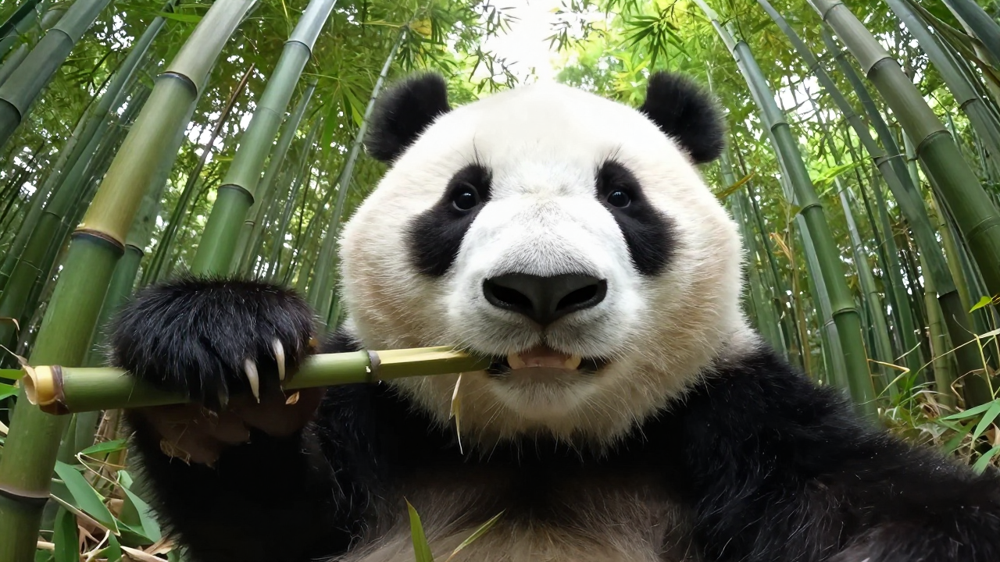
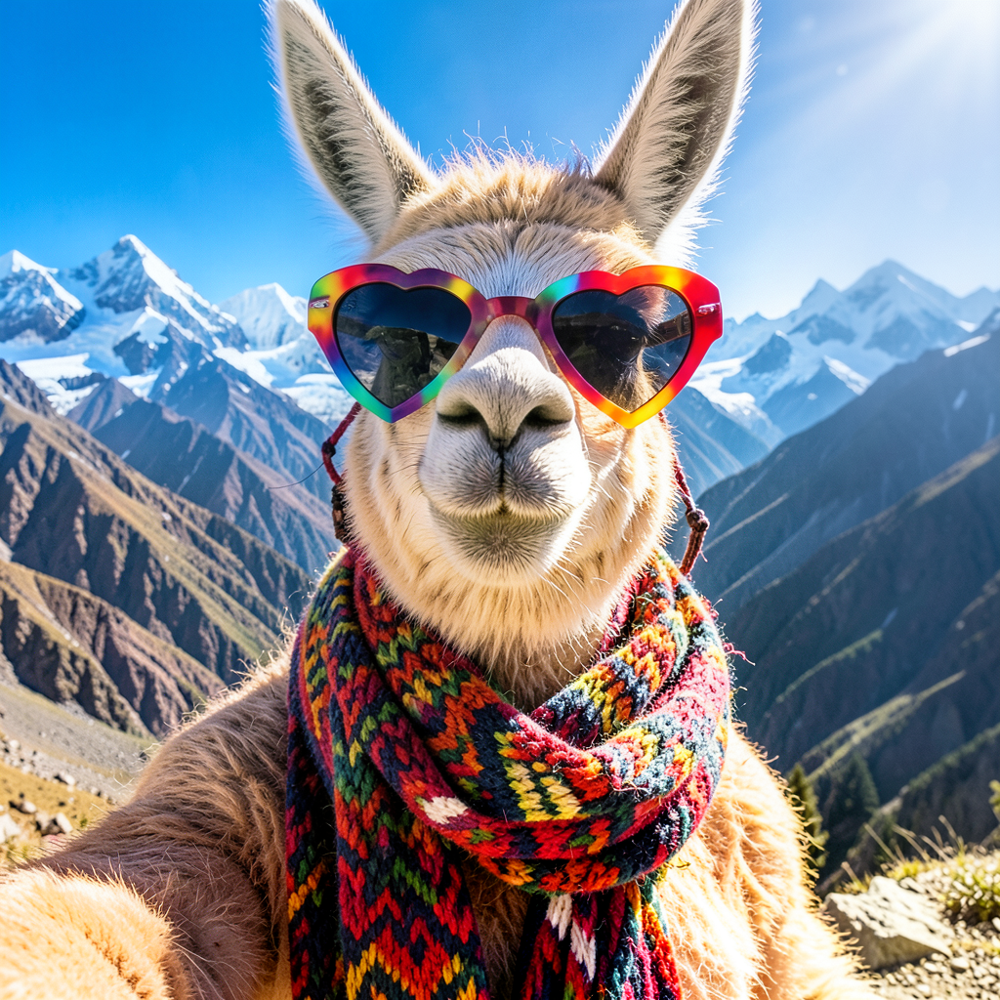
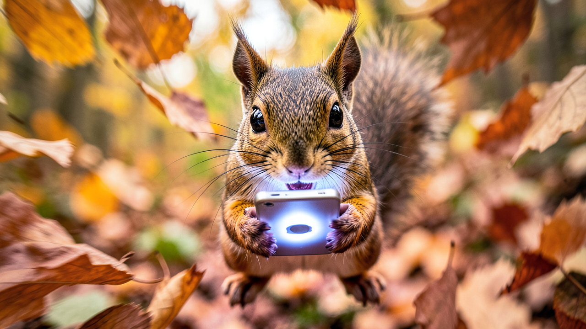

# Funny Animal Selfies

**Status:** verified Fruth reference run  
**Run and review date:** 2026-10-10  
**Response:** `resp_1791661239229_7c1d95e8eecee8`  
**Final frame:** `resp_1791661239229_7c1d95e8eecee8:frame-2`

## Request

```text
Create a playful series of exactly three funny animal selfies. Choose the animals, settings, poses, and visual style yourself, but make the three images clearly distinct. Then inspect each generated image separately and briefly describe only what is actually visible, including any accidental readable text or obvious visual defect.
```

## Result

Three distinct saved images show a panda with bamboo, a llama wearing heart-shaped sunglasses in a mountain landscape, and a squirrel holding a phone among autumn leaves. Publication review viewed all three images without modifying them.

### Image 1



### Image 2



### Image 3



## Recorded combined inspection

The model-authored inspection is preserved as returned:

> **Structured Output — Generated Images Inspection**
> 
> | # | Branch Artifact | Visible Content Summary | Readable Text | Visual Defects |
> |---|-----------------|-------------------------|---------------|----------------|
> | 1 | branch-vision_analysis-1 | Fisheye photograph of a giant panda eating bamboo in a dense forest. Panda face dominates frame, gazing at camera; black eye patches, ears, nose on white fur; open mouth with visible teeth while chewing; long claws gripping a green bamboo stalk (lower-left); tall vertical bamboo stalks and leaves filling background under bright daylight. | None present. | None reported. Fisheye distortion is intentional lens effect. |
> | 2 | branch-vision_analysis-2 | A llama centered in foreground wearing colorful sunglasses and a multi-colored knitted scarf, against rugged snow-capped mountains under a clear blue sky. | None mentioned. | None mentioned. |
> | 3 | branch-vision_analysis-3 | A single squirrel centered, holding a glowing smartphone with both paws, set among out-of-focus brown/orange autumn fallen leaves. | Explicitly stated: no readable text present. | None mentioned. |
> 
> **Notes:** Each image is distinct (panda / llama / squirrel); no shared artifact reference reused across identities. Text/defect status reported per branch evidence; branches 2 and 3 are brief summaries without explicit defect observations, while branch 1 provides the most detailed inspection.

Digest-bound dispatch establishes which image was supplied to each consumer. It does not guarantee every visual interpretation.

## Image-consumption evidence

```json
[
  {
    "producer_phase": "phase-2",
    "artifact_ref": "artifact:image_4df1d3a3854064624e876ad2",
    "inspection_model": "ornith-1.5:9b",
    "dispatch_evidence": {
      "authority": "runtime_vision_image_dispatch",
      "branch_id": "branch-vision_analysis-1",
      "image_sha256": "218fa26b467afe31f01915411b047ae5c03b6d4eeff79fda492a76df3b9b1cf5",
      "instance_id": "ornith-1.5:9b-1",
      "kind": "fruth.vision_input_evidence",
      "phase_id": "phase-5",
      "response_id": "resp_1791661239229_7c1d95e8eecee8",
      "size_bytes": 1467044,
      "status": "supplied",
      "version": 1
    }
  },
  {
    "producer_phase": "phase-3",
    "artifact_ref": "artifact:image_4ee357c75241568c8523ba49",
    "inspection_model": "mlx-community/gemma-4-E4B-it-qat-8bit",
    "dispatch_evidence": {
      "authority": "runtime_vision_image_dispatch",
      "branch_id": "branch-vision_analysis-2",
      "image_sha256": "59ad9c64cf216ccaa8f33aa0e1d250729ee4917c579e05e34d5a3d99ea12df19",
      "instance_id": "mlx-community__gemma-4-E4B-it-qat-8bit-mlx-11501",
      "kind": "fruth.vision_input_evidence",
      "phase_id": "phase-6",
      "response_id": "resp_1791661239229_7c1d95e8eecee8",
      "size_bytes": 1942739,
      "status": "supplied",
      "version": 1
    }
  },
  {
    "producer_phase": "phase-4",
    "artifact_ref": "artifact:image_5093abf6afe7a757c027d49e",
    "inspection_model": "gemma4:26b",
    "dispatch_evidence": {
      "authority": "runtime_vision_image_dispatch",
      "branch_id": "branch-vision_analysis-3",
      "image_sha256": "d77f96912a1ca115f6d6e1fd5cfcb4f24438ac655dbd572dfd9998c28b15e5f6",
      "instance_id": "gemma4:26b-1",
      "kind": "fruth.vision_input_evidence",
      "phase_id": "phase-7",
      "response_id": "resp_1791661239229_7c1d95e8eecee8",
      "size_bytes": 1515797,
      "status": "supplied",
      "version": 1
    }
  }
]
```

## Runtime truth and monitor

The final response is terminal and completed. Late Fill, the materialization contract, Closure and surface state are fulfilled, with no pending or failed branches. The independent monitor reports `clean` for this exact final frame; no missing files, hash mismatches or HTML/CSS issues were reported.

The monitor report was recorded at `2026-10-10T20:20:56.284003Z` after execution, during backlog reconciliation. Source artifacts were rechecked during this export.

Monitor phase timings are diagnostic observations, not a benchmark. Backfilled event-window fields can include another response’s activity (the Echoes image-wave end is later than its own terminal output); these phase-duration fields are retained as observed but are not used to admit a reference or compare performance.

## Scope

This is one recorded local execution of the exact prompt. It supplements the dated conformance results; it does not establish a general success rate or a new AFM/PCC verdict. The original response frame and runtime artifacts remain authoritative.

## Publication Package

This directory is a sanitized, immutable publication copy of the reviewed run. It does not replace the original response frame or runtime artifacts.

- [Exact reviewed prompt](prompt.txt)
- [Sanitized final response truth](response.json)
- [Sanitized independent monitor snapshot](monitor-report.json)
- [Package checksums and provenance](manifest.json)
